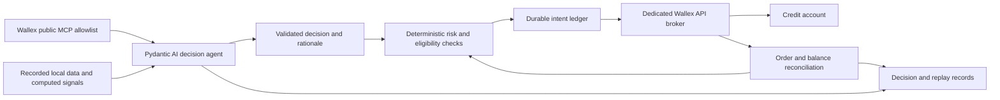

# Open-source foundations for the Wallex challenge

Researched: 2026-10-23. Scope: 28 repositories screened through primary repository metadata, selected source/configuration files, and official documentation. This is an architecture recommendation, not a measured profitability comparison. No third-party software was installed, no trading credentials were shared, and no orders were placed.

## Recommendation

**Use Pydantic AI for the runtime decision agent, Wallex's hosted MCP for narrowly allowed public market-data tools, and a small dedicated Wallex execution/risk service.** This is my engineering recommendation for the short event window: it fits the Python code already started, gives AI a genuine decision role, and avoids porting an entire exchange framework. Pydantic AI supports typed outputs and MCP integration. [Repository](https://github.com/pydantic/pydantic-ai), [structured output documentation](https://pydantic.dev/docs/ai/core-concepts/output/), [MCP documentation](https://pydantic.dev/docs/ai/capabilities/mcp/).

**Condor is the best complete trading-specific harness I found to investigate further.** It supplies agent loops and connects to Hummingbot's execution infrastructure. Its default trading path still needs a Wallex connector or custom integration. Its checked package requires Python `>=3.12,<3.14`, while this machine's Python is 3.14.7, so adoption needs a separate compatible environment. [Condor](https://github.com/hummingbot/condor), [package configuration](https://github.com/hummingbot/condor/blob/main/pyproject.toml).

**LangGraph is the strongest alternative when explicit workflow state and checkpoint recovery are the main priority.** Use it instead of a second orchestration layer. Checkpoint persistence does not replace an exchange order ledger or reconciliation. [Persistence documentation](https://docs.langchain.com/oss/python/langgraph/persistence).

These rankings are judgments about fit and integration scope. I have not run the candidate systems or verified their live performance.

## Important discovery: Wallex already has a hosted MCP server

I connected to `https://api.wallex.ir/mcp` without an API key, initialized MCP protocol `2025-03-26`, and successfully requested `tools/list`. The server identified itself as `api.wallex.ir`, version `1.0.0`, and listed **52 tools**. Only protocol discovery was performed; no tool was executed. Full public tool descriptions and input schemas are saved in `wallex-public-mcp-tools.json`.

An initial market-data allowlist can be:

```text
wallex_basic_get_markets
wallex_basic_candle_history
wallex_basic_get_market_depth
wallex_basic_get_latest_trades
```

Those four schemas require no credential parameter. Discovery alone does not establish that every tool call will succeed. The returned schemas have no read-only annotations, so use the explicit reviewed allowlist. The full catalog also contains private account and state-changing operations; do not expose all 52 to the model.

The existing exchange key belongs in the execution service's local credential loader. Model-provider access is a separate credential/configuration question. The supplied Wallex key cannot substitute for an AI provider key.

## Ranked shortlist

| Project | Checked license | Useful capability | Work specific to our challenge | Verdict |
| --- | --- | --- | --- | --- |
| [Pydantic AI](https://github.com/pydantic/pydantic-ai) | MIT | Typed agent loop, validated output, MCP | Bind market tools and our risk/execution service | **Recommended lightweight base** |
| [Condor](https://github.com/hummingbot/condor) | MIT | Trading agent loops, journal, Hummingbot integration | Wallex integration and Python environment | **Best complete trading harness candidate** |
| [LangGraph](https://github.com/langchain-ai/langgraph) | MIT | Explicit workflow and persistent checkpoints | Trading tools, ledger, broker | Best alternative orchestration base |
| [Gordon](https://github.com/general-liquidity/gordon) | MIT | Trading-oriented agent, deterministic limits, scheduled autonomy | TypeScript/Bun stack and Wallex venue adapter | Interesting second complete harness |
| [NautilusTrader](https://github.com/nautechsystems/nautilus_trader) | LGPL-3.0 | Event-driven simulation and execution engine | Custom Wallex adapter and engine integration | Strong longer-term foundation; larger event scope |
| [Freqtrade + FreqAI](https://github.com/freqtrade/freqtrade) | GPL-3.0 | Crypto bot plus predictive-model workflows | Wallex integration below its exchange abstraction | Useful research reference; substantial integration |
| [TradingAgents](https://github.com/TauricResearch/TradingAgents) | Apache-2.0 | Financial multi-agent analysis | Wallex data, execution, and short-horizon adaptation | Borrow analysis patterns selectively |
| [QuantHarness](https://github.com/Y-Research-SBU/QuantHarness) | MIT | Indicator/pattern/trend agent analysis | Wallex feeds and actual order lifecycle | Research scaffold, not an established Wallex broker |
| [Deep Agents](https://github.com/langchain-ai/deepagents) | MIT | General harness with memory, filesystem, planning | Restrict tools and add all trading semantics | Better for research work than our execution loop |
| [OpenAlice](https://github.com/TraderAlice/OpenAlice) | AGPL-3.0 | Local agent trading workspace | Wallex broker pack and autonomous challenge path | Workspace/UI adds scope we do not need |

Condor's documentation distinguishes chat confirmation from unattended loop risk gates. It routes trades through executors and its Hummingbot API tool surface. A custom Wallex MCP server cannot be assumed to replace that path automatically. [MCP tool architecture](https://condor.hummingbot.org/trading-agents/mcp-tools).

Gordon documents an automatic mode alongside supervised modes. Its crypto route uses CCXT, so Wallex integration still needs work. Its checked package requires Node `>=22.22.0` and Bun `>=1.0`; the README and package requirements should be reconciled at the selected revision. [Repository](https://github.com/general-liquidity/gordon), [package configuration](https://github.com/general-liquidity/gordon/blob/main/package.json).

NautilusTrader can share strategy implementations between simulation and live operation, with venue adapters handling integration. That is attractive after the event; adapter and execution complexity remain real work. [Adapter guide](https://nautilustrader.io/docs/latest/developer_guide/adapters/).

FreqAI supplies training, forecasting, retraining, and backtesting workflows. However, I found no Wallex entry in the checked CCXT Python exchange registry or Freqtrade support lists. The current Hummingbot spot connector directory also had no Wallex entry. This is evidence about those registries, not a claim that no community fork exists anywhere. [FreqAI](https://www.freqtrade.io/en/latest/freqai/), [CCXT registry](https://github.com/ccxt/ccxt/blob/master/python/ccxt/__init__.py), [Hummingbot connectors](https://github.com/hummingbot/hummingbot/tree/master/hummingbot/connector/exchange).

TradingAgents now documents crypto tickers and point-in-time improvements, so calling it stock-only would be inaccurate. Its own README still describes variable LLM-driven research results. QuantHarness accepts price data and produces analytical trade directives; the checked documentation does not establish a complete Wallex execution system. [TradingAgents](https://github.com/TauricResearch/TradingAgents), [QuantHarness](https://github.com/Y-Research-SBU/QuantHarness).

## A repository for this exact challenge

[ssepehrnoush/wallex-ai-trader](https://github.com/ssepehrnoush/wallex-ai-trader) explicitly identifies the same Starcoach Agentic AI Wallex challenge and reports MIT licensing. It describes local fair-value reversion, two MCP connections, AI-gated entries, hard-coded risk limits, and decision logging. The inspected client supports the `sub-account-client-id` header and avoids blindly retrying order creation.

This is the closest domain-specific reference found. It is also another participant's challenge implementation. Keep authorship and attribution explicit and check the organizer's reuse rule before incorporating participant code. Its reported returns and live-operation claims were not independently verified. A public repository is not evidence that its strategy will win for our account.

Recommendation: use it to identify missing account-routing and recovery requirements. Keep our own measured strategy, implementation decisions, and submission evidence. Directly adopting another team's finished challenge submission carries different originality implications from using a general-purpose framework.

## Wallex-specific MCP and SDK candidates

| Project | Evidence | Role |
| --- | --- | --- |
| [iran-crypto-mcp](https://github.com/sepehr071/iran-crypto-mcp) | MIT; explicitly unofficial and public-data-only; Python 3.10+ | Optional comparison data across Iranian venues; needs no exchange key |
| [SajjadKiani/wallex-mcp-server](https://github.com/SajjadKiani/wallex-mcp-server) | Python MCP wrapper; no license file or detected license in checked root/metadata | Reference only until reuse permission is established |
| [mhsenpc/wallex_mcp_server](https://github.com/mhsenpc/wallex_mcp_server) | Go wrapper; README says MIT, but checked root had no license file | Limited public market/candle reference |
| [amirSamanQ/python-wallex](https://github.com/amirSamanQ/python-wallex) | No detected license; uses floating-point amounts and retrying order calls; no sub-account header found in checked module | Do not adopt as our execution foundation |
| [amiwrpremium/wallex-python](https://github.com/amiwrpremium/wallex-python) | GPL-3.0; last reported push in 2022; linked upstream returned 404 | Older API reference, low priority |

The hosted Wallex MCP removes much of the reason to install an unverified community wrapper just to expose public data. Cross-venue data can inform research; all challenge execution must stay within the allowed Wallex account and markets.

## Additional candidates screened

| Project | Checked license | Assessment for this event |
| --- | --- | --- |
| [Qlib](https://github.com/microsoft/qlib) | MIT | Broad ML quant research platform; data integration still required |
| [RD-Agent](https://github.com/microsoft/RD-Agent) | MIT | Autonomous research/factor development; substantial research scope |
| [FinRL](https://github.com/AI4Finance-Foundation/FinRL) | MIT | Reinforcement-learning research; training and environment design add scope |
| [FinRobot](https://github.com/AI4Finance-Foundation/FinRobot) | Apache-2.0 | Current desktop generation emphasizes equity research and valuation |
| [LEAN](https://github.com/QuantConnect/Lean) | Apache-2.0 | Broad trading engine; larger integration/deployment project |
| [Jesse](https://github.com/jesse-ai/jesse) | MIT core | Supports custom research data; Wallex absent from checked supported-live list; live product has separate tiers |
| [backtesting.py](https://github.com/kernc/backtesting.py) | AGPL-3.0 | Small backtesting component, no Wallex execution harness |
| [vectorbt](https://github.com/polakowo/vectorbt) | Apache-2.0 **with Commons Clause** | Source-available research candidate; do not label it plain permissive open source |
| [Microsoft Agent Framework](https://github.com/microsoft/agent-framework) | MIT | General agent orchestration; still needs trading components |
| [HKUDS/AI-Trader](https://github.com/HKUDS/AI-Trader) | README claims MIT; GitHub license metadata absent | Research candidate; license grant and execution scope need further inspection |
| [CCXT](https://github.com/ccxt/ccxt) | MIT | Useful exchange abstraction; checked registry has no Wallex implementation |

Sources for the important scope distinctions: [FinRL README](https://github.com/AI4Finance-Foundation/FinRL), [FinRobot README](https://github.com/AI4Finance-Foundation/FinRobot), [Jesse supported exchanges](https://docs.jesse.trade/docs/supported-exchanges/), [Jesse tiers](https://jesse.trade/pricing), [vectorbt license](https://github.com/polakowo/vectorbt/blob/master/LICENSE.md).

## Proposed revised build



1. Keep the 345-pair exclusion manifest, decimal accounting, risk rules, and intent-log concepts from the initial work. The existing custom engine is unfinished and has no CLI yet; it must not be treated as a deployed system.
2. Replace the planned custom agent loop with one Pydantic AI agent. Give it reviewed public-data tools and computed numeric signals. Use structured outputs for candidate selection, abstention, rationale, and expiry. Portfolio sizing belongs to deterministic code.
3. Let AI decisions genuinely gate entries, while exits and recovery continue independently of model availability. Keep inference off the order-monitoring path.
4. Keep exchange credentials entirely in the broker process. Require verified credit-account routing and account-allowed markets before any live deployment. The challenge deadline remains missing.
5. Record tool inputs/outputs and model decisions for replay. Framework checkpoints cannot establish that an exchange order was accepted exactly once; client IDs and reconciliation still do that work.
6. Choose a small strategy hypothesis and measure it after actual costs. Local pricing dislocation relative to a coherent coin/USDT and USDT/TMN reference is one hypothesis to compare with momentum; it is not an established edge.

This research does not add a test suite or execute downloaded code. The earlier local implementation is preserved. The next concrete build decision is the recommended lightweight stack; a full Condor migration remains an alternative if its operational features justify the extra integration.

## Evidence files

- `open-source-repository-registry.json`: all 28 repositories, repository-reported licenses, branches, push timestamps, source URLs, and observed HEAD commits for five leading candidates.
- `wallex-public-mcp-tools.json`: the public 52-tool MCP discovery response, with no credential or account data.
- `excluded-markets.json`: complete exclusions from the supplied challenge file.

Repository metadata and branch contents can move independently while being inspected. The registry records observations, not a reproducible dependency lock. Pin release/commit and dependency versions when a foundation is adopted.
