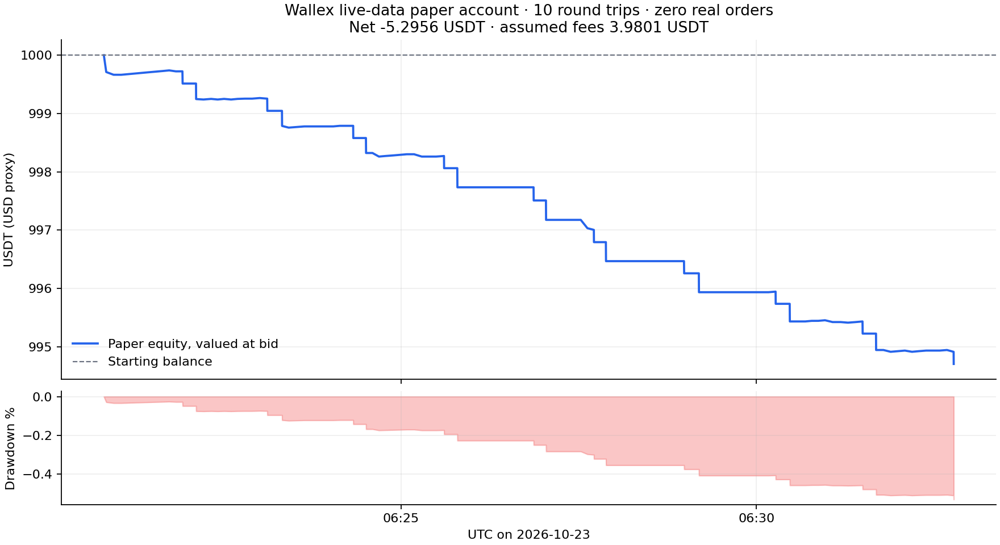
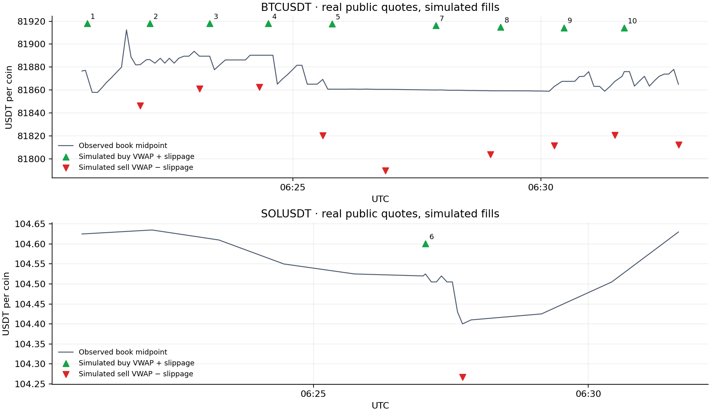
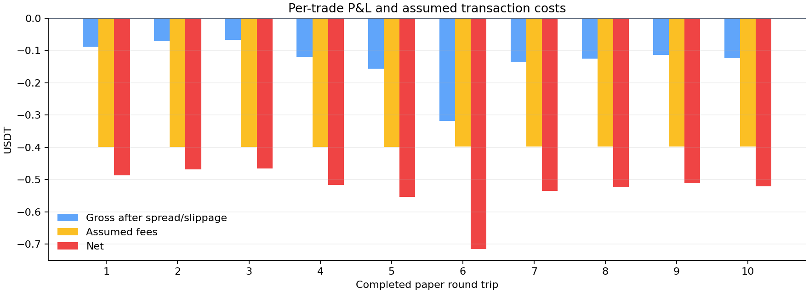

# Live-data paper session

Status: complete. Completed round trips: 10.

Started: 2026-10-23T06:20:24.508294+00:00. Finished: 2026-10-23T06:32:46.589209+00:00.

All fills are local simulations using real public Wallex books; no exchange account or real orders.

Initial: 1000.00 USDT. Final cash: 994.7044 USDT. Net P&L: -5.2956 USDT.
Gross P&L before assumed fees: -1.3155 USDT. Fees: 3.9801 USDT.
Maximum observed account drawdown: 0.5296%.

USDT is a dollar proxy. Assumed fee: 0.2% each side; extra slippage: 1 basis point each side.
A local learned model ranks real candle signals. This fixed-count one-minute experiment samples
opportunities even when the predicted net return is negative, to exercise execution and measure costs.
It is not a production positive-edge entry policy or evidence of profitability.

| # | Market | Open (UTC) | Close (UTC) | Entry | Exit | Gross USDT | Fees USDT | Net USDT | Exit |
|---:|---|---|---|---:|---:|---:|---:|---:|---|
| 1 | BTCUSDT | 06:20:51 | 06:21:55 | 81917.99098 | 81846.24456 | -0.0874 | 0.3990 | -0.4864 | timed_exit |
| 2 | BTCUSDT | 06:22:07 | 06:23:07 | 81917.97098 | 81861.00308 | -0.0694 | 0.3989 | -0.4682 | timed_exit |
| 3 | BTCUSDT | 06:23:19 | 06:24:19 | 81917.99098 | 81862.63292 | -0.0674 | 0.3987 | -0.4661 | timed_exit |
| 4 | BTCUSDT | 06:24:30 | 06:25:36 | 81918.02098 | 81820.47713 | -0.1187 | 0.3984 | -0.5171 | timed_exit |
| 5 | BTCUSDT | 06:25:47 | 06:26:51 | 81917.84096 | 81789.83450 | -0.1556 | 0.3981 | -0.5538 | timed_exit |
| 6 | SOLUSDT | 06:27:02 | 06:27:42 | 104.60046 | 104.26723 | -0.3171 | 0.3976 | -0.7147 | stop_loss |
| 7 | BTCUSDT | 06:27:53 | 06:28:58 | 81916.36082 | 81803.64882 | -0.1369 | 0.3976 | -0.5345 | timed_exit |
| 8 | BTCUSDT | 06:29:11 | 06:30:16 | 81914.97068 | 81811.53298 | -0.1256 | 0.3975 | -0.5230 | timed_exit |
| 9 | BTCUSDT | 06:30:28 | 06:31:29 | 81914.38062 | 81820.76710 | -0.1136 | 0.3973 | -0.5108 | timed_exit |
| 10 | BTCUSDT | 06:31:40 | 06:32:46 | 81914.21060 | 81812.05798 | -0.1239 | 0.3970 | -0.5209 | timed_exit |

Artifacts: `trades.csv`, `results.json`, `status.json`, and `trace.sqlite3` (raw GET responses, model coefficients/inputs, quotes, decisions, fills, and equity observations).

## Independent reconciliation

- Local time: 2026-10-23 09:50:24 to 10:02:46 (Asia/Tehran).
- Confirmed 10 simulated buys and 10 simulated sells; no open inventory.
- All 175 captured exchange requests were public GETs.
- Each model's training labels were available before its entry.
- Real observed midpoint movement contribution: -0.143949 USDT.
- Spread, depth impact and added slippage: 1.171529 USDT.
- Assumed fees: 3.980076 USDT.
- Net P&L: -5.295555 USDT.
- One SOL candidate was rejected for exceeding the spread limit; no failed HTTP requests were recorded.
- SQLite integrity and cash/fee reconciliation passed.

The fixed-count probe policy permits negative estimated net returns. This run shows the cost of
that short sampling policy; it does not evaluate a production strategy with a positive-net-edge gate.

