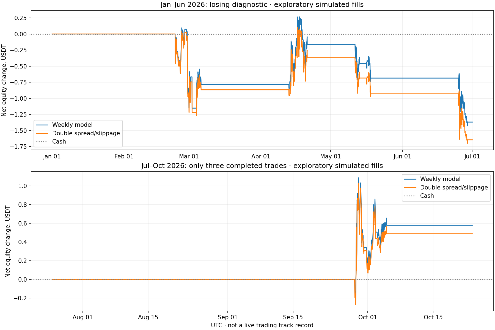

# Weekly learned-return iteration

**Exploratory historical research on previously inspected periods. No real orders.**

This iteration was motivated by the monthly model's lag. It retrains every Monday on 90 days
of training followed by 14 separate calibration days. All other model, cost and risk settings stay fixed.

| Phase | Model | Trades | Wins | Win rate | Net USDT | Stressed net | Profit factor | Observed DD |
|---|---|---:|---:|---:|---:|---:|---:|---:|
| validation | ridge | 17 | 5 | 29.4% | -1.5804 | -1.9136 | 0.499 | 0.268% |
| validation | hist_gradient_boosting | 35 | 18 | 51.4% | +3.1899 | +2.2853 | 1.478 | 0.215% |
| diagnostic | hist_gradient_boosting | 13 | 4 | 30.8% | -1.3682 | -1.6441 | 0.561 | 0.169% |
| recent_previously_seen | hist_gradient_boosting | 3 | 3 | 100.0% | +0.5785 | +0.4878 | N/A | 0.096% |

The recent 3/3 wins are a tiny sample, **not evidence of a dependable 100% win rate**.
The same strategy lost in January–June 2026. Positive validation and one small green slice do not establish a durable edge.

Approved for a paper forward candidate: **False**. Real-money execution remains disabled.

- check:insufficient_completed_trades
- check:nonpositive_net_pnl
- check:nonpositive_stressed_net_pnl
- check:weak_profit_factor
- recent:insufficient_completed_trades
- recent:does_not_beat_matched_control

## Matched controls

The 48h momentum control made -8.4133 USDT in January–June and +1.9935 USDT in the recent July–October diagnostic.
It shares the liquidity filter, cost assumptions, 1,000-USDT wallet, 100-USDT entry cap and 0.1% planned account risk.

## Integrity and limits

- Every training label ends before calibration starts; every calibration label ends before the weekly fit cutoff.
- The replay predictions use past data, but the strategy architecture was adjusted after inspecting these periods. This is not a virgin holdout or prospective live result.
- Current market selection/spreads proxy past conditions. Actual fee tier was not verified; fees remain 0.2% per side.
- OHLC fills, gap exits, extra slippage and sampled drawdown are simulations. Historical depth impact is unavailable.
- Risk was not increased to improve the headline. Doubling spread/slippage is reported for every case.
- Both candidate models and all failed cases remain saved. No exchange orders, paid model API or external messages were used.

Verified 95 weekly model hashes/cutoffs and all completed trade ledgers. Predictions, serialized models, JSON traces and CSV trades are adjacent.

