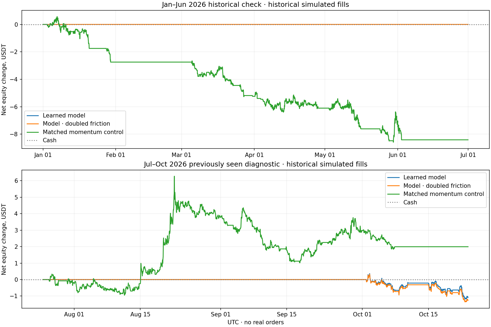

# Learned-return study

Local, monthly refitted models; historical simulated fills only. No exchange orders.

Validation-selected model: **{'model': 'hist_gradient_boosting', 'horizon_hours': 48}**.

| Phase | Model | Hours | Trades | Wins | Win rate | Net USDT | Stressed net | Profit factor | Observed DD |
|---|---|---:|---:|---:|---:|---:|---:|---:|---:|
| validation | ridge | 24 | 34 | 15 | 44.1% | -3.0624 | -3.6937 | 0.536 | 0.386% |
| validation | ridge | 48 | 33 | 14 | 42.4% | -5.4837 | -6.1364 | 0.341 | 0.628% |
| validation | hist_gradient_boosting | 24 | 67 | 24 | 35.8% | -2.5100 | -3.9411 | 0.736 | 0.472% |
| validation | hist_gradient_boosting | 48 | 70 | 37 | 52.9% | +3.7965 | +2.2338 | 1.301 | 0.462% |
| historical_check | hist_gradient_boosting | 48 | 0 | 0 | N/A | +0.0000 | +0.0000 | N/A | 0.000% |
| recent_previously_seen | hist_gradient_boosting | 48 | 8 | 1 | 12.5% | -1.0831 | -1.2595 | 0.288 | 0.154% |

## Matched non-ML controls

These use the same liquidity filter, starting wallet, size/risk caps, daily ATR stop, decision times, holding horizon and costs.
They enter positive 7/28-day momentum above EMA200, rather than using a learned forecast. All control cases are retained.

| Phase | Hours | Trades | Wins | Net USDT | Stressed net |
|---|---:|---:|---:|---:|---:|
| validation | 24 | 102 | 45 | -1.8838 | -4.4034 |
| validation | 48 | 58 | 27 | +0.3182 | -1.1375 |
| historical_check | 24 | 81 | 24 | -9.4484 | -11.2942 |
| historical_check | 48 | 43 | 14 | -8.4133 | -9.2903 |
| recent_previously_seen | 24 | 65 | 25 | -2.5360 | -4.6509 |
| recent_previously_seen | 48 | 34 | 15 | +1.9935 | +0.7199 |

**Approved for a future paper forward test: False. Real money enabled: False.**

- check:insufficient_completed_trades
- check:nonpositive_net_pnl
- check:nonpositive_stressed_net_pnl
- recent:nonpositive_net_pnl
- recent:nonpositive_stressed_net_pnl
- recent:weak_profit_factor
- recent:does_not_beat_matched_control

## Method

Fixed Ridge and histogram gradient boosting models, at 24h and 48h horizons. Each UTC month refits on past data only.
Of the trailing 180 days, 150 are training and 30 are calibration. Forward labels crossing cutoffs are purged.
Calibration intervals do not overlap within each asset; assets can still be correlated. Overlapping training labels reduce the effective sample size.
The model predicts next-open to horizon-open net returns after both fees and assumed execution costs.
Positive overprediction is subtracted; calibration must contain at least five cost-qualified positive-mean entries before the month can trade.
There is no random training/test split or hyperparameter search. Boosting uses fixed 100 iterations, seven leaves and disabled early stopping.
Candidate decisions require predicted net return >=0.3%. A zero-trade month is an abstention, not a winning trade or established trading edge.

## Limits

- The model was selected on July–December 2025 validation. January–June 2026 and July–October 2026 are separate historical diagnostics, but their prices had already been examined using other strategies. They are not virgin holdouts.
- The positive validation result did not establish a durable edge: the chosen model abstained in the first check and lost in the recent period.
- Historical quote spreads use frozen present-day proxies, and the present-day universe has selection/survivorship assumptions. Actual account fees remain unverified.
- Simulated OHLC fills are not exchange-confirmed. Stops/gaps can exceed planned risk and historical depth impact is unavailable.
- Stress holds entry signals fixed and doubles spread/slippage. No fee discount or higher risk produced these results.
- This study is a local supervised model, not a real LLM trading track record or an enabled broker.

The wallet starts at 1,000 USDT; maximum entry spend is 100 USDT/10% equity and planned account risk is 0.1%. Fees remain 0.2% each side.
Verified 34 monthly fit cutoffs and serialized model hashes, plus every completed trade ledger.

Artifacts: `validation.json`, `check.json`, `matched_controls.json`, `readiness.json`, `audit.json`, `models/`, gzip prediction CSVs and per-trade CSVs.

