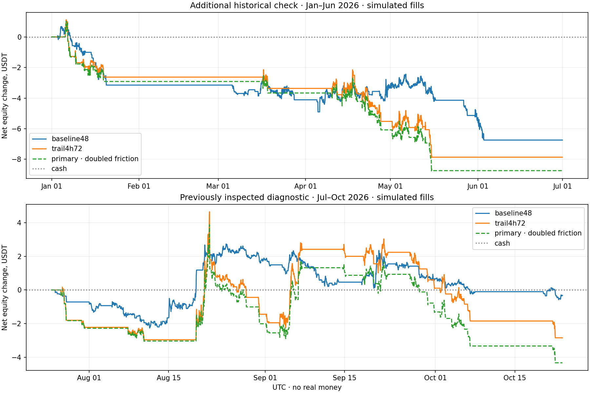

# Managed trend study

Historical, simulated fills only. No real orders, credentials or new live trades.

Qualified on validation: **trail4h72**. Predeclared primary: **trail4h72**.

Every variant uses 1,000 USDT, at most 100 USDT all-in per entry and 0.1% planned account risk.
Fees remain 0.2% each side. Stress doubles spread and additional slippage; it does not lower fees.

| Phase | Candidate | Trades | Net wins | Win rate | Net USDT | Stressed net | Profit factor | Observed DD |
|---|---|---:|---:|---:|---:|---:|---:|---:|
| development | baseline48 | 49 | 18 | 36.7% | -5.3578 | -6.8430 | 0.575 | 0.767% |
| development | retained_regime48 | 17 | 5 | 29.4% | -0.9983 | -1.3947 | 0.697 | 0.139% |
| development | trail4h72 | 24 | 10 | 41.7% | -0.5955 | -1.8057 | 0.938 | 0.496% |
| development | pullback4h72 | 18 | 5 | 27.8% | -4.7629 | -5.4741 | 0.475 | 0.576% |
| validation | baseline48 | 61 | 25 | 41.0% | -6.4680 | -8.3385 | 0.609 | 1.036% |
| validation | retained_regime48 | 17 | 7 | 41.2% | +1.7505 | +1.2791 | 1.536 | 0.193% |
| validation | trail4h72 | 23 | 10 | 43.5% | +7.0429 | +5.6102 | 1.907 | 0.345% |
| validation | pullback4h72 | 19 | 5 | 26.3% | -3.2817 | -4.1967 | 0.638 | 0.703% |
| earlier_uninspected | baseline48 | 40 | 15 | 37.5% | -6.7434 | -8.1148 | 0.434 | 0.742% |
| earlier_uninspected | trail4h72 | 22 | 3 | 13.6% | -7.8629 | -8.7416 | 0.134 | 0.899% |
| recent_previously_seen | baseline48 | 33 | 12 | 36.4% | -0.3302 | -1.9143 | 0.955 | 0.330% |
| recent_previously_seen | trail4h72 | 23 | 4 | 17.4% | -2.8385 | -4.3204 | 0.775 | 0.745% |

## Same-period references

The BTC reference spends 100 USDT once and holds; actual exposure and stop risk differ from the active systems.

| Phase | Cash net USDT | 100-USDT BTC holding net USDT |
|---|---:|---:|
| development | 0 | +13.2207 |
| validation | 0 | -18.1186 |
| earlier_uninspected | 0 | -33.4446 |
| recent_previously_seen | 0 | +27.2558 |

## Periods and interpretation

- Development: January–June 2025. Validation/selection: July–December 2025.
- Additional historical check: January–June 2026, whose raw prices had not been inspected in the earlier study.
- Recent diagnostic: July 25–October 23, 2026. That period was already inspected; it is explicitly not a fresh holdout.
- The strategy ideas were developed in October 2026, after seeing later market behavior. Even an uninspected earlier-price check does not reproduce a prospective experiment run before that period.
- Baseline uses the same newly captured warmup history as the new variants. Its results can differ from the old +0.8822 replay, which had less warmup.
- Validation qualification is fixed before the additional check. If no candidate qualifies, the predeclared primary still gets a research check; it is not relabeled qualified.

## Implemented controls

Current spread proxy above 30 bps excludes new managed entries. BTC's completed 4h trend controls regime eligibility.
The retained candidate keeps valid positions through the old 48h timeout, capped at 72h, and exits on regime loss.
The primary uses completed 4h trend and ATR, a 2-ATR initial stop and a 3-ATR trailing stop updated only from prior closed hourly prices.
There is no fixed profit cap. Positions exit on weakening trends or a 72h hard limit. A separate pullback variant is reported too.

## Limitations

- Historical spreads are frozen current proxies, not historical order books. Present-day eligible markets create survivorship and selection assumptions.
- Hourly OHLC fills cannot reconstruct queue priority or intrabar execution. Stop/target ambiguity remains adverse-first; gaps fill at the observed open.
- Drawdown is observed at closes and fills; intrabar equity can be worse. Stops do not guarantee the planned dollar risk.
- Stress fixes entry signals while changing execution costs and risk-sized quantities. It is a robustness test, not a second independent sample.
- Signals are deterministic rules, not an LLM trading track record. None of these scripts can submit an exchange order.
- No result guarantees a future win rate or return. Real-money trading is not enabled.

All source/data hashes and the experiment specification are in `frozen.json`. `development.json`, `validation.json` and `check.json` retain all trades and equity traces.
Independent wallet, fee, timing and risk checks are in `ledger_checks.json`; every case has a trade CSV.

