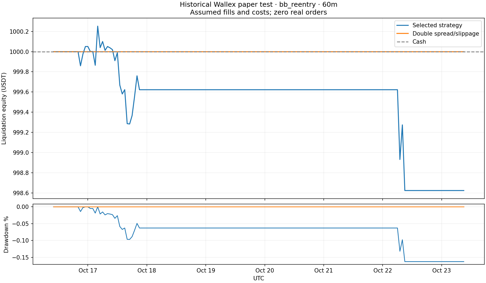

# Indicator strategy experiment

Historical evaluation; not a new prospective live session. No real orders.

Selected for research using validation: **bb_reentry**, 60-minute entries.
Passed original promotion criteria: **False**. Live strategy remains disabled.
Final holdout: 2026-10-16 09:00 UTC to 2026-10-23 09:00 UTC.

| Evaluation | Round trips | Net wins | Win rate | Final USDT | Net USDT | Observed drawdown |
|---|---:|---:|---:|---:|---:|---:|
| Full holdout | 2 | 0 | 0.0% | 998.6230 | -1.3770 | 0.163% |
| First ten or fewer | 2 | 0 | 0.0% | 998.6230 | -1.3770 | 0.163% |
| Double spread/slippage | 0 | 0 | N/A | 1000.0000 | +0.0000 | 0.000% |

Holdout fees: 0.4189 USDT. Profit factor: 0.0. Average net trade: -0.6884900686902817 USDT.
Cash benchmark net: 0.00 USDT. 100-USDT BTC holding reference net: -1.2843 USDT (different exposure and risk).

## Every validation candidate

Validation was reused during development; only the final holdout is untouched by candidate selection.

| Candidate | Minutes | Trades | Wins | Net USDT | Selected |
|---|---:|---:|---:|---:|---|
| trend_pullback | 15 | 2 | 0 | -1.8546 |  |
| macd_bb_filtered | 15 | 0 | 0 | +0.0000 |  |
| macd_bb_unfiltered | 15 | 2 | 0 | -2.3095 |  |
| supertrend | 15 | 5 | 0 | -4.9863 |  |
| bb_reentry | 15 | 2 | 0 | -0.5025 |  |
| donchian_breakout | 15 | 19 | 3 | -11.0315 |  |
| trend_pullback | 60 | 2 | 0 | -1.4032 |  |
| macd_bb_filtered | 60 | 0 | 0 | +0.0000 |  |
| macd_bb_unfiltered | 60 | 1 | 0 | -0.2710 |  |
| supertrend | 60 | 2 | 0 | -2.1043 |  |
| bb_reentry | 60 | 4 | 2 | -0.0256 | yes |
| donchian_breakout | 60 | 5 | 0 | -4.4132 |  |

## Limits

- Exploratory candidate FAILED the original promotion criteria; it was chosen before opening this holdout and is not enabled for live trading.
- Historical candle fills, not prospective live fills or exchange-confirmed trades.
- Historical spread assumption is max(15 bps round trip,current measured spread); historical books are unavailable.
- Fees 0.2% each side; additional slippage 1 bp each side. Stress doubles spread and slippage.
- One seven-day holdout and multiple development candidates; a positive result is not proof of a durable edge.
- Original live 10-trade run covers another period; the return comparison is descriptive, not matched-period evidence.
- Observed drawdown uses candle closes and fills; intrabar drawdown can be worse.
- The original three-pair eight-candidate validation failed and is preserved in the previous capture directory.
- Twelve eligible present-day markets create possible survivorship bias; current spreads are proxies for past spreads.
- Long indicators use observed candles; no synthetic candles fill gaps. Signals require recent contiguous data.
- A small historical sample cannot establish a reliable future win rate.

Independent ledger checks: `ledger_check.json`. Full results and selection: `holdout.json`, `selection.json`.
Per-trade CSVs: `holdout_trades.csv`, `first_ten_holdout_trades.csv`, `cost_stress_trades.csv`.

