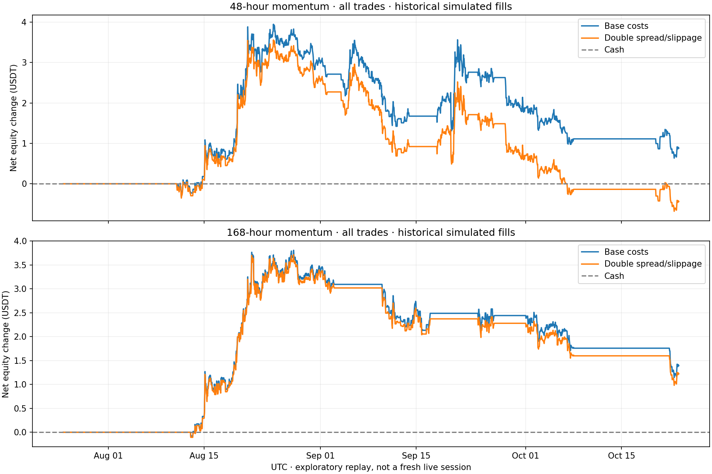

# Lower-turnover momentum results

**Exploratory historical backtest. No real money or exchange orders.**

These rules were fixed before this replay, after the earlier indicator development/validation results had been inspected.
This is not a new untouched holdout or a prospective live result. All variants and previous failures are retained.

| Variant | Trades | Wins | Win rate | Final USDT | Net USDT | Fees | Profit factor | Observed DD |
|---|---:|---:|---:|---:|---:|---:|---:|---:|
| 48h full | 28 | 12 | 42.9% | 1000.8822 | +0.8822 | 1.3846 | 1.161 | 0.330% |
| 48h stress | 28 | 12 | 42.9% | 999.5608 | -0.4392 | 1.3228 | 0.926 | 0.422% |
| 48h first ten or fewer | 10 | 6 | 60.0% | 1002.9149 | +2.9149 | 0.5744 | 4.170 | 0.111% |
| 168h full | 7 | 2 | 28.6% | 1001.3931 | +1.3931 | 0.3170 | 1.639 | 0.265% |
| 168h stress | 7 | 2 | 28.6% | 1001.2222 | +1.2222 | 0.3048 | 1.533 | 0.272% |
| 168h first ten or fewer | 7 | 2 | 28.6% | 1001.3931 | +1.3931 | 0.3170 | 1.639 | 0.265% |

Replay period: 2026-07-25 09:00 UTC through 2026-10-23 09:00 UTC.
First eligible actual entry: 2026-08-11 00:00 UTC; earlier data supports indicator warmup.

## What changed

At scheduled UTC midnights, require positive 7-day and 28-day returns and a close above the hourly EMA200.
Seven-day movement must exceed twice assumed round-trip costs. Rank eligible markets by cost-adjusted
seven-day return divided by recent volatility. Trade one spot-long position; hold up to 48 hours or,
for the separate reference, 168 hours. Use a stop at two daily ATR and a 2R net target.

Risk stays at 0.1% of current equity (about 1 USDT initially), with a maximum 100-USDT all-in spend.
Daily ATR makes many positions smaller than 100 USDT. Fees remain 0.2% each side. Historical spread
uses max(15 bps round trip, current measured per-market spread), with another 1 bp adverse slippage
per side. These are assumptions about past execution, not reconstructed historical books.

## Interpretation

The 48h full replay has positive net P&L and more than zero winning trades. Its first ten trades
look substantially better than the complete 28-trade series; use the full series for assessment.
The 48h result turns negative under doubled execution friction. The weekly reference stays positive
under that stress but cannot complete a full weekly holding period inside a three-day challenge.

Both positive full-period results were driven by August gains; September and October-to-date lost equity.
For the 48h case, monthly liquidation-equity changes were approximately +2.9804, -1.1079 and -0.9903 USDT.
This is evidence of regime dependence, not an established improvement for today's market.

The 100-USDT BTC holding reference made **+27.2558 USDT** over the same dates,
more than either momentum variant. It holds a different exposure and accepts different risk;
the study does not establish superiority over passive holding.

The original live 0/10 and -5.2956 USDT result used different dates and execution observations.
Comparing it with this backtest is descriptive, not evidence of improved prospective performance.
The earlier research candidate failed its final seven-day holdout: 0/2 wins, -1.3770 USDT.
Its [full results](../evaluation/RESULTS.md), all validation candidates and initial failed selection remain available.

Other limits: current-market universe creates survivorship bias; sparse history and missing candles;
close/fill drawdown sampling misses some intrabar risk; simulated targets/stops are not guaranteed fills.
Stress keeps base entry signals fixed while changing fill costs and risk-sized quantities.
No LLM was used in the new signal rules. These are rule-based research candidates; no real broker was enabled.

## Artifacts

- `results.json`: all variant results, every trade, equity trace, configuration and hashes.
- `frozen.json`: both variant specifications and source/data hashes recorded before evaluation.
- `*_trades.csv`: complete fills and P&L for each case.
- `ledger_checks.json`: independently recomputed wallet, fees, timing, spend and planned-risk checks.

